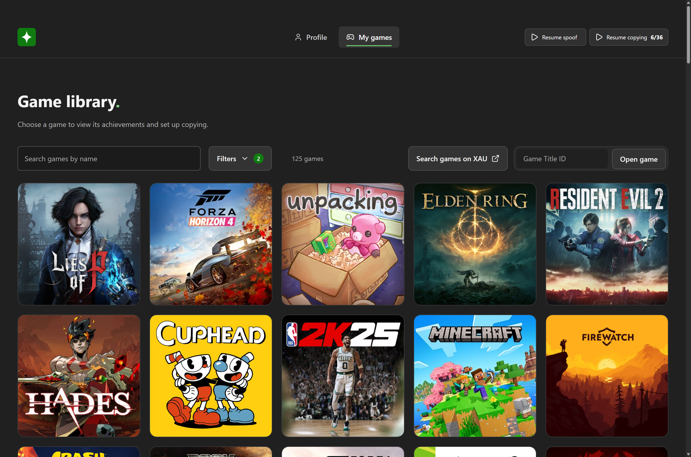

# Xbox Achievment Hunter

A Windows companion app for Xbox achievement hunting, with automatic unlocking, customizable queues, playtime spoofing, and game stats.



## Download

Download the portable Windows `.exe` from [GitHub Releases](https://github.com/egorrya/xbox-achievment-hunter/releases/latest). Open the Xbox PC app and sign in, then run the downloaded file. No installation or Node.js is required.

## Features

- Browse your profile, games, and achievements.
- Copy an Xbox player's achievement history with a customizable queue, or import a matching history from a linked public Steam profile.
- Start and stop playtime spoofing and manage running processes from the header.
- View and edit supported game statistics.
- Keep profile data separate by account. The queue pauses and spoofing stops when the app closes.

## Build from source

Requires Node.js 22.12 or later.

```sh
npm ci
npm run build:win
```

The portable executable is created in `dist/`.

## Credits

Built with [Electron](https://www.electronjs.org/) and [Lucide](https://lucide.dev/), using [XAU](https://xau.lol/) and [TrueAchievements](https://www.trueachievements.com/). Xbox integration references [Xbox Achievement Unlocker](https://github.com/Fumo-Unlockers/Xbox-Achievement-Unlocker), its [caiobrasuca fork](https://github.com/caiobrasuca/Xbox-Achievement-Unlocker), and [Achievement Labs](https://github.com/Achievement-Labs/achievement-labs). Xbox Achievement Unlocker is GPL-licensed; see its repository for details.
